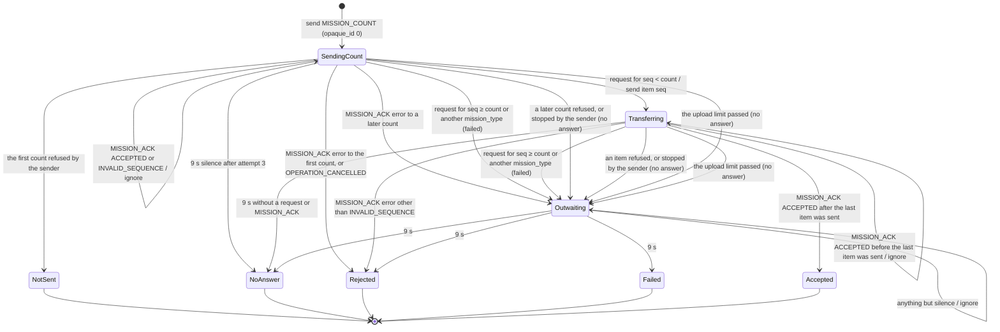

# 0010. Upload a route as a state machine the vehicle drives

- Status: Proposed
- Date: 2026-11-28
- Issue: #151

## Context

v0.5 uploads a validated route (REQ-055) to ArduCopter with the mission protocol
([mavlink.io `services/mission.html`](https://mavlink.io/en/services/mission.html)): the GCS sends MISSION_COUNT, the
vehicle asks for each item and ends with MISSION_ACK. The protocol gives no timeouts and no number of attempts. What
the vehicle does was read in ArduPilot's code (master `6034266b5a`, the version captured in #148):

- **The count.** `handle_mission_count` refuses a count with `MAV_MISSION_NO_SPACE`, `DENIED` (another GCS uploading)
  or a failed allocation **before** touching the mission. Otherwise it calls `truncate(count)` at once, cutting the
  stored mission to `count` items, and asks for item 0. A new count from the same system and component restarts the
  upload (`cancel_upload`), so sending the count again is safe.
- **The requests.** The vehicle asks with MISSION_REQUEST, not MISSION_REQUEST_INT (`GCS_config.h`, #148). It asks
  for the same item again every `1000 + stream_slowdown` ms and gives up 8 s (`upload_timeout_ms`) after the last item
  it received, with MISSION_ACK `OPERATION_CANCELLED` and "Mission upload timeout" (`MissionItemProtocol::update`).
- **The items.** An item other than the one asked for gets MISSION_ACK `INVALID_SEQUENCE` and the upload goes on, so
  a repeated request answered twice draws an error that ends nothing; QGroundControl 5.0.8 ignores it from ArduPilot
  (`PlanManager::_handleMissionAck`). An item the vehicle cannot store gets an error ACK and ends the upload. Each item
  stored replaces or appends at its index, so until the last one the vehicle holds the route's first items, then what
  is left of its previous mission up to `count`.
- **The end.** After the last item, `transfer_is_complete` sends MISSION_ACK `ACCEPTED` once; it is never repeated. A
  MISSION_ACK from the GCS is "not used" (`GCS_Common.cpp`), so a GCS cannot cancel an upload. While an upload runs,
  MISSION_REQUEST_LIST is answered `DENIED`.
- **Item 0 is home.** `AP_Mission::replace_cmd` and `set_item` never write index 0 ("it must be home"). In #148,
  QGroundControl sent item 0 as NAV_WAYPOINT, frame `MAV_FRAME_GLOBAL`, `current` 1, `z` 585.0 m, and the vehicle sent
  its own home back with `z` 587.15 m. On a vehicle whose mission was never written, `add_cmd` stores home first and
  keeps item 0's content at index 1 until item 1 replaces it.

Measured on ArduCopter SITL 4.8.0-dev (git `5b556d3f`, Mission Planner's simulator, #151): a count never answered was
asked for again 0.98 to 1.06 s apart and given up 7.99 s after it with `OPERATION_CANCELLED`; an item sent twice drew
`INVALID_SEQUENCE` and the next request; a new count mid-upload restarted at seq 0; a download meanwhile was
`DENIED`; a 3-item upload cut after item 1, over a 5-item mission, left home, the new take off and the old item 2; a
count of 651 got `NO_SPACE` and left the mission untouched; MISSION_CLEAR_ALL got `ACCEPTED` and left no item, home
included; item 0 sent at 584 m came back as the vehicle's home at 587.15 m.

QGroundControl waits 1500 ms (`_ackTimeoutMilliseconds`) for each answer and sends the count up to 6 times
(`_maxRetryCount` 5). If the vehicle then goes silent, QGroundControl fails the upload after 1500 ms.

## Decision

The upload is a pure state machine in `:data:vehicle`, driven by the vehicle's messages and by timeouts, with its
states and transitions exactly as drawn:

A MISSION_ACK of another `mission_type` and any message that is no part of an upload are ignored in every state,
keeping the running wait.

- **The plan is checked outside the codec, before the machine:** a plan that breaks a rule is not sent. It holds
  home and at least one item; every item has `seq` equal to its index, `mission_type` 0 and `current` and
  `autocontinue` 0 or 1; item 0 is home's placeholder, sent as QGroundControl sends it (NAV_WAYPOINT,
  `MAV_FRAME_GLOBAL`, `current` 1) at the vehicle's home (#152). Its content is stored only on a vehicle whose
  mission was never written, as item 1 until item 1 replaces it (`AP_Mission::add_cmd`). The count goes with
  `opaque_id` 0 ("0 on upload to the vehicle from GCS", `common.xml`). The codec keeps any uint8 and uint32 (#148).
- **The count: 3 attempts**, the first two waiting 1.5 s each as commands do (ADR 0008), the third 9 s: 12 s at
  most. A count that arrived starts the vehicle's 8 s, so after the last one the GCS outwaits it like any silence.
- **The items: never sent unasked.** Every MISSION_REQUEST or MISSION_REQUEST_INT for a seq below the count is
  answered with that MISSION_ITEM_INT, repeated or out of order. The vehicle does the retrying.
- **Silence while transferring: 9 s**, ArduPilot's 8 s plus 1 s for the round trip. The wait restarts only on a
  request or MISSION_ACK the machine takes from this upload's vehicle and route, never on telemetry. Every result
  therefore comes once the vehicle has stopped receiving, so the next upload or a read of the mission (#153) is not
  refused as `DENIED`, and its late `OPERATION_CANCELLED` cannot reach the next upload.
- **A whole upload is bounded**: 12 s for the count (every attempt unanswered), then 3 s per item, home included,
  so 495 s for REQ-055's 160 items. 3 s is three of the vehicle's own requests for an item, which SITL sent 0.98 to
  1.06 s apart: two lost exchanges per item on average, or a round trip 3 s long, as on a slow radio. Past it, the
  upload ends as no answer with what the vehicle may hold, so requests or `INVALID_SEQUENCE` that keep coming,
  unsigned until v0.6, never hold it open.
- **Whatever ends while the vehicle may still receive is outwaited.** A refused send or a stop by the sender (#152)
  ends as no answer with its reason, the upload limit as no answer, a bad request as failed, and an error to a later
  count (the count before it may have reached the vehicle) as rejected; each comes 9 s later, with nothing more sent
  or taken meanwhile, since the vehicle's 8 s count from the last item it received, which came before.
- **`INVALID_SEQUENCE` is ignored**, and `ACCEPTED` counts only once the last item was sent: before that it cannot be
  this upload's. While the count is sent, `ACCEPTED` and `INVALID_SEQUENCE` are ignored, and `OPERATION_CANCELLED`
  says a count arrived and its upload timed out; any other error refuses the count before `truncate`.
- **One result per upload**, each failure saying what the vehicle may now hold, never assumed:
  - not sent: nothing left, so its previous mission;
  - rejected while sending the first count: its previous mission, refused before `truncate`; rejected later, or
    `OPERATION_CANCELLED`: its previous mission, cut to `count` items;
  - no answer to the count: its previous mission, cut to `count` items if a count arrived;
  - failed or no answer while transferring, or `OPERATION_CANCELLED`: the route's first items up to the highest one
    asked for (one more if it was sent), then what is left of the previous mission up to `count`; an item refused:
    the items before it only;
  - failed is a request past the count or for another `mission_type`, which is no `MAV_MISSION_RESULT`.
- **A mission left partial is cleared**, with MISSION_CLEAR_ALL after the failure, in a follow-up issue that adds
  message 45 to the codec. `AP_Mission::clear` refuses only while armed with the mission running, and an upload goes
  only disarmed; an empty mission makes `present()` false, so `ModeAuto::init` refuses AUTO while armed. The clear can
  fail too, over the same link that just failed: the start from the app (#153, #155) still refuses a mission on board
  that is not the validated route.
- **Gates and identity are the sender's (#152).** The machine knows nothing of the link: the sender checks every gate
  under its lock before each send and gives the machine only messages from the pinned route, the active system ID and
  this session.

## Alternatives considered

### QGroundControl's timings (1.5 s for every answer, count sent up to 6 times)
- Pros: the reference GCS.
- Cons: it fails after 1.5 s of silence while the vehicle keeps asking for 8 s; the vehicle is still receiving when the
  operator reads the result, and a read of the mission is refused.
- Why not: the GCS would give up long before the vehicle it talks to.

### Resend the last item on silence
- Pros: the GCS bounds its own retries and ends sooner.
- Cons: it sends items the vehicle did not ask for, which ArduPilot answers with `INVALID_SEQUENCE`; the vehicle asks
  again by itself anyway.
- Why not: the vehicle drives the dialogue.

### Count attempts of 1.5 s each, with #153 retrying a read refused as `DENIED`
- Pros: no answer to the count shows after 4.5 s instead of 12 s.
- Cons: a count that arrived keeps the vehicle receiving for 8 s after it; the read that says what the vehicle holds
  must then tell a `DENIED` for this reason from one for another GCS's upload, and the next upload can meet the late
  `OPERATION_CANCELLED`.
- Why not: ending after the vehicle keeps one rule for every result.

### Treat a partial mission as a known limit only
- Pros: no new protocol code.
- Cons: AUTO selected on the transmitter flies the partial mission, which may end without RTL or LAND and hold items
  of an earlier mission judged against another home.
- Why not: it stays the fallback when the clear fails, not the plan.

## Consequences

- Positive: every upload ends in one result the operator can read, with what the vehicle may hold; the GCS never
  gives up before the vehicle's own timeout, and by 1 s at most after it.
- Negative / costs we accept: an upload cut by a lost uplink takes 9 s to end, 12 s when no count was answered; a
  lost final `ACCEPTED` ends as no answer while the vehicle holds the whole route, so the mission is read back
  (#153); a stale error ACK from another upload of this GCS can reject a new one; the ACK is unsigned until v0.6
  (`docs/security.md`, N-2), so a forged one from the pinned route can fake a result.
- Follow-ups: MISSION_CLEAR_ALL after a failed upload (new issue, before #152); the sender's gates (#152); reading the
  mission back and refusing a start on a mission that is not the route (#153, #155).
